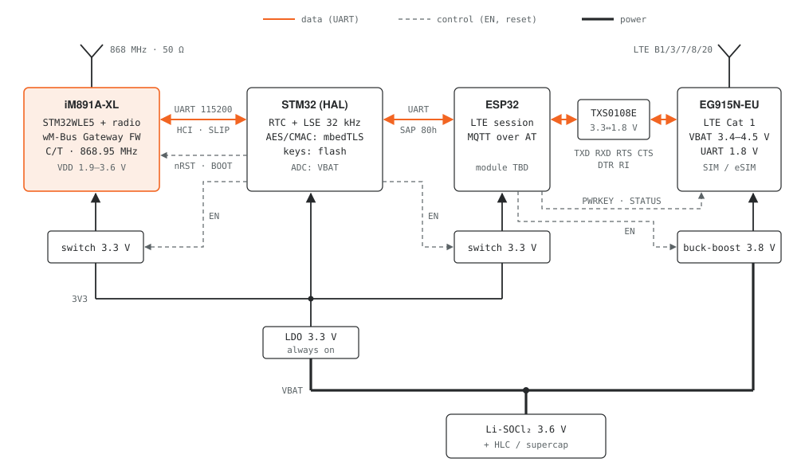
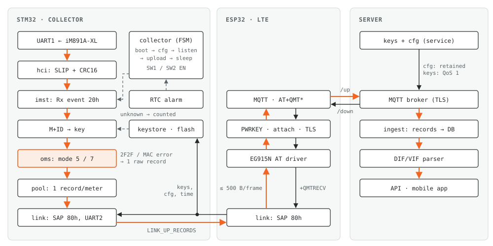
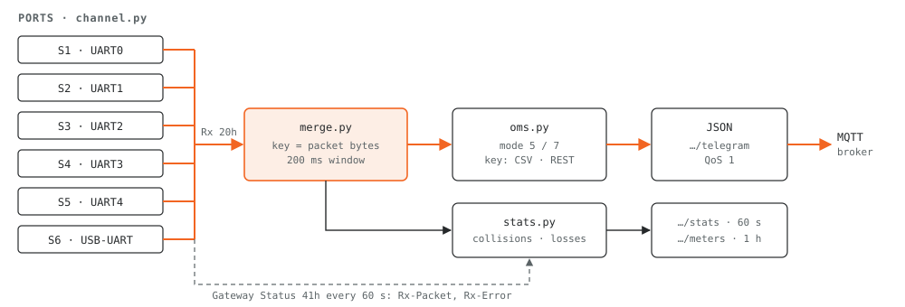
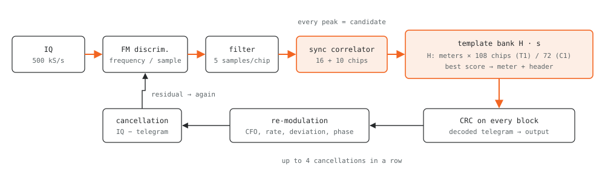
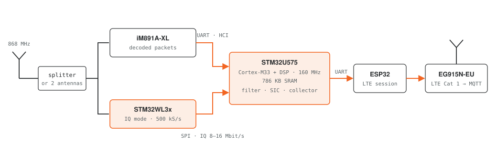

<picture>
  <source media="(prefers-color-scheme: dark)" srcset="docs/img/eu/BG_Co-fundedbytheEU_RGB_NEG.png">
  
</picture>

# wM-Bus gateway

Wireless M-Bus (EN 13757-4 / OMS) receiver stack for a fixed reading network:
battery gateways with LTE Cat 1 backhaul, 6-sector base stations, and the receiver
DSP that separates overlapping telegrams with an address-template matched filter.

The network replaces drive-by / walk-by reading. Meters keep transmitting as they
do today (T1 / C1, 868.95 MHz), the receivers pick the telegrams up, decrypt them
and push them to the server over MQTT.

[Български](README.bg.md)

```
gateway/       STM32 firmware for the battery gateway (iM891A-XL + ESP32 + EG915N-EU)
basestation/   Python service for the 6-sector base station on a Raspberry Pi 5
dsp/           receiver DSP: sync correlator, Walsh-domain address templates, SIC
docs/img/      block diagrams (SVG)
```

## Project and funding

The software and technical materials published here relate to the implementation of project BG16RFPR001-1.001-0061-C01 "Development of innovations in Skorpion 7 OOD".

- Beneficiary: Skorpion 7 OOD („Скорпион 7“ ООД)
- Implementation period: 12.03.2025–12.09.2026

The project is carried out with the financial support of the European Regional Development Fund through the Programme "Competitiveness and Innovation in Enterprises" 2021–2027.

Its aim is to develop and demonstrate a noise-immune, asynchronous and energy-autonomous telemetry system for remote collection and transmission of data from metering devices.

Within the project, an autonomous battery-powered Wireless M-Bus gateway with direct data transmission over LTE Cat 1 has been developed, together with the required software components and data processing tools.

### Published materials

This repository provides public access to:

- software components for the battery gateway controller;
- a software service for a six-sector base station;
- a reference implementation and simulations for radio signal processing, including matched filtering, address templates in the Walsh–Hadamard domain and processing of overlapping telegrams;
- technical descriptions, block diagrams, example configurations, tests and simulation results.

The status and limitations of the individual components are described in the respective directories. The reference simulations are kept separate from the implementations for specific hardware.

The publication supports the dissemination of the results and allows them to be studied and verified technically.

Date of initial public release: 15.10.2026

Responsibility for the content lies with Skorpion 7 OOD. The views expressed do not necessarily represent the official position of the European Union or of the Managing Authority of the Programme.

## Battery gateway

One IMST iM891A-XL receives C/T mode telegrams, an STM32 decrypts them (OMS
security modes 5 and 7), and an ESP32 drives a Quectel EG915N-EU that publishes
the records over MQTT/TLS. The radio listens in windows scheduled by the server
(default once a day, 180 s), everything except the STM32 is power-switched off
between windows.





Details, pinout and the STM32 <-> ESP32 protocol: [gateway/README.md](gateway/README.md)

## Base station

Six iM891A-XL modules, one per 60° sector, on five GPIO UARTs and one USB-UART of
a Raspberry Pi 5. The same transmission heard by several sectors is merged into one
MQTT message with the list of sectors and RSSI values. The service also estimates
collisions per sector from the module counters and the airtime of each telegram.



Details: [basestation/README.md](basestation/README.md)

## Receiver DSP

A gateway with a plain wM-Bus radio receives at most one of two telegrams that
overlap in time. With IQ samples (STM32WL3x in IQ mode, 500 kS/s) the receiver
does better:

1. the sync correlator runs on every sample, also inside a telegram that is
   already being received, so every peak becomes a candidate;
2. a bank of address templates (one row per known meter: C, M, ID, version,
   type) identifies the meter from the soft header chips, also with chip errors.
   The bank can run in the Walsh-Hadamard domain with a reduced set of
   coefficients (modified Walsh address matrix);
3. a decoded telegram is re-modulated with the estimated CFO, chip rate,
   deviation and phase and subtracted from the IQ; detection runs again on the
   residual.



With two overlapping telegrams and one of them at least 3 dB stronger, both are
received in 75–98 % of the cases; a single demodulator gets both in 0 %. Full
numbers, the Walsh-domain comparison and the compute budget for the target MCU are
in [dsp/README.md](dsp/README.md).



## Build and test

```sh
# gateway firmware, host tests (gcc, mbedTLS, python3-cryptography)
make -C gateway/test

# base station
cd basestation && pip install -r requirements.txt && python3 -m unittest discover -s tests

# DSP
cd dsp && pip install numpy cryptography && python3 -m unittest discover -s tests
python3 experiments.py 200          # -> results/results.json
python3 experiments_walsh.py 200    # -> results/results_walsh.json
```

The firmware tests run with ASan/UBSan. Mode 7 key derivation matches the OMS
Annex N vectors (Kenc `EC CF 39 D4 …`, Kmac `C9 CD 19 FF …`), the HCI CRC and ping
frame match the IMST specification. Encrypted test telegrams are produced by an
independent Python implementation (`gateway/test/gen_vectors.py`).

## Roadmap

- STM32WL3x IQ capture (DMA + SPI to the main MCU) and the DSP chain in C on STM32U575
- lab test with NUCLEO-WL33, two signal sources and attenuators
- ELL (CI 8C/8D, AES-CTR) and security mode 10
- flash persistence of keys and schedule on the gateway (`port_stm32_hal.c`)
- measured current profile of the LTE session

## References

- IMST iM891A-XL datasheet V1.1, WM-Bus Gateway HCI Protocol Specification V2.4,
  WM-Bus Gateway Firmware Feature Overview V1.4
- Quectel EG915N Series Hardware Design V1.1/V1.2, MQTT Application Note V1.4
- OMS Specification Vol. 2, Annex N
- EN 13757-4, EN 13757-7
- TI AN067 (SWRA234), Silicon Labs AN451, ST AN4772
- STM32WL3x, STM32U575 datasheets

## License

MIT, see [LICENSE](LICENSE). The EU emblem in `docs/img/eu/` is not covered by this license; its use is governed by the EU rules.
