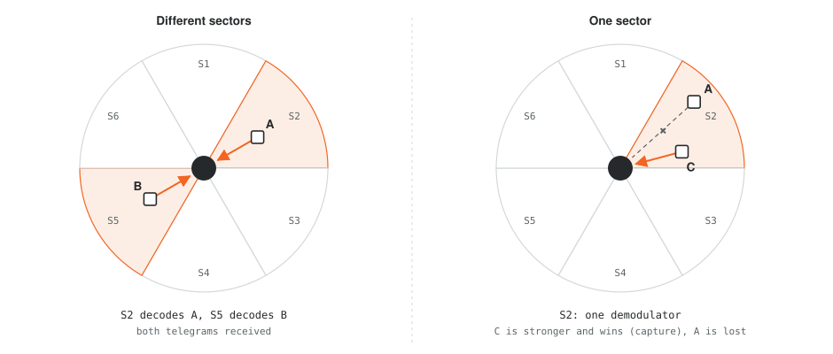
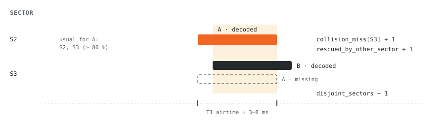

# Base station

Python service for the 6-sector base station: six IMST iM891A-XL modules, one per
60° sector, on a Raspberry Pi 5 (Python ≥ 3.11).

- C/T mode by default, link mode configurable per sector
- 5 GPIO UARTs + 1 USB-UART
- one MQTT message per transmission, with the list of sectors that heard it
- `…/stats` every 60 s, `…/meters` every hour

## How sectors separate simultaneous telegrams



Each sector has its own demodulator. Telegrams arriving in different sectors do not
disturb each other as long as the antennas suppress the neighbouring sectors well
enough. Within one sector at most one of two overlapping telegrams survives
(capture effect: the stronger one wins if the signal-to-interference ratio is high
enough). A telegram lost in a collision comes again with the meter's next
transmission. S1 meters are on 868.3 MHz, T1/C1 on 868.95 MHz, so one sector has to
be in S mode for S1 meters.

## Software


- each port: SLIP + CRC16, ping until the module answers, Get Config -> patch Link
  Mode, Rx notification, filter off -> Set Config. A lost port is re-initialised.
- merge: the module drops packets with a bad CRC, so all copies of one transmission
  are byte-identical. The packet bytes are the merge key, window 200 ms.
- decryption once per telegram, not per copy. Key by M + ID from a CSV file or a
  REST service with a cache.
- receive time = host time − UART transfer time − module latency (parameter).

| Module | |
|---|---|
| `hci.py` | SLIP + CRC16 |
| `imst.py` | HCI messages, Rx event 20h, Gateway Status 41h/42h |
| `channel.py` | one serial port / sector, init, reconnect |
| `merge.py` | copies -> one telegram with sector list |
| `airtime.py` | time on air per mode and length |
| `oms.py` | security modes 5 and 7 |
| `keys.py` | key store: CSV / JSON file, REST with cache |
| `stats.py` | collision and loss estimation |
| `output.py` | MQTT publisher |
| `app.py` | entry point |

## Collisions

The module does not report collisions. They are derived from three things: the
module counters, which sectors usually hear a given meter, and the airtime of each
telegram.



Overlap is computed from the receive time and the telegram length, so these numbers
are a statistical estimate.

| Field in `/stats` | Meaning |
|---|---|
| `telegrams` · `copies` · `multi_sector` | unique telegrams, all copies, telegrams heard by more than one sector |
| `overlap_pairs.disjoint_sectors` | telegrams overlapping in time and received in different sectors |
| `overlap_pairs.shared_sector` | overlapping but received in the same sector. One demodulator can't do that, so this points to a timing error: tune `module_latency_ms` until it is ≈ 0 |
| `sectors[].collision_miss` | a usual sector missed the meter while decoding another overlapping telegram |
| `rescued_by_other_sector` | of those, how many were received by another sector |
| `sectors[].other_miss` | a usual sector missed the meter without a visible overlap: weak signal, interference or a collision with an undecoded telegram |
| `sectors[].module_rx_errors` | module Rx-Error counter ("CRC or decoding errors") |
| `lost_on_all_sectors_est` | transmissions missing in all sectors, from the meter's period (median interval) |

Airtime: T mode is 100 kchip/s, 3-out-of-6 (12 chips per byte), preamble
≥ 19 × `01`, sync 10 chips, postamble up to 8 chips; format A is 10 B + CRC, then
16 B blocks + CRC. L = 0x2A gives 51 bytes on air, 6.68 ms. C and S mode preamble
and sync lengths are config parameters.

## MQTT

Topics: `<topic_prefix>/<station_id>/telegram`, `…/stats`, `…/meters`, `…/status`
(retained, last will `{"online": false}`).

`…/telegram`:

```json
{
  "v": 1, "station": "BS-VT-001", "seq": 18234,
  "ts": "2026-10-12T07:15:03.412Z",
  "m": "KAM", "id": "12345678", "ver": 27, "type": 7,
  "mode": "C-A", "acc": 115, "dec": "ok",
  "rssi": -67, "sector": 3,
  "rx": [{"s": 3, "rssi": -67}, {"s": 2, "rssi": -81}],
  "telegram": "2e442d2c785634121b077a73…"
}
```

With `dec = ok` the encrypted part of `telegram` is replaced by the decrypted one.
Other values: `plain`, `no_key`, `check_fail`, `mac_fail`, `unsupported`.

`…/stats` (shortened):

```json
{
  "telegrams": 912, "copies": 1534, "multi_sector": 451,
  "overlap_pairs": {"both_received": 7, "disjoint_sectors": 7, "shared_sector": 0},
  "rescued_by_other_sector": 3,
  "lost_on_all_sectors_est": 2,
  "sectors": [{"s": 3, "telegrams": 288, "only_here": 96,
    "collision_miss": 2, "other_miss": 5,
    "module_rx": 301, "module_rx_errors": 11, "module_error_ratio": 0.0353}],
  "ports": [{"s": 1, "port": "/dev/ttyAMA0", "ready": true}]
}
```

`…/meters` holds per meter: main sector, mean RSSI and hit rate per sector, period
and loss estimate.

## Wiring and setup

| Sector | RPi 5 overlay | GPIO TX / RX |
|---|---|---|
| S1 | `dtoverlay=uart0-pi5` | 14 / 15 |
| S2 | `dtoverlay=uart1-pi5` | 0 / 1 |
| S3 | `dtoverlay=uart2-pi5` | 4 / 5 |
| S4 | `dtoverlay=uart3-pi5` | 8 / 9 |
| S5 | `dtoverlay=uart4-pi5` | 12 / 13 |
| S6 | USB-UART | `/dev/serial/by-path/…` |

- Check the `/dev/ttyAMA*` names on the device. For the USB-UART use the stable
  by-path name so the sector does not move after a reboot.
- GPIO 0/1 are the HAT ID EEPROM pins; make sure the board does not use the HAT
  EEPROM before taking them for a UART.

```sh
pip install -r requirements.txt
sudo mkdir -p /etc/wmbus-bs && sudo cp config.example.toml /etc/wmbus-bs/config.toml
python3 -m wmbus_bs.app /etc/wmbus-bs/config.toml
# or as a service: wmbus-bs.service (WorkingDirectory=/opt/wmbus-bs, user wmbus, group dialout)
```

## Tests

```sh
python3 -m unittest discover -s tests
python3 tests/bench.py
```

18 tests: HCI (ping frame from the spec), mode 5/7 decryption (KDF = OMS Annex N),
merging, four collision scenarios, REST key lookup, and a full run with six
simulated modules on pseudo-terminals. Without serial ports and MQTT the pipeline
does 12,500–13,300 telegrams/s on one Xeon core at 2.8 GHz.
