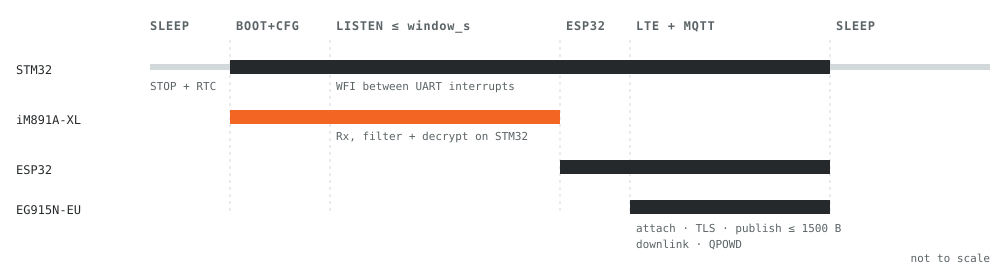

# Battery gateway firmware

STM32 firmware for the battery wM-Bus gateway. C99, STM32 HAL, mbedTLS.

- radio: IMST iM891A-XL with the WM-Bus Gateway firmware, C/T mode, 868.95 MHz
- host: STM32 (HAL), the only part that is always powered
- decryption on the STM32: OMS security mode 5 and mode 7 (KDF, AFL MAC, IV = 0), 2F2F check
- uplink: STM32 -> ESP32 -> Quectel EG915N-EU (LTE Cat 1) -> MQTT/TLS
- receive windows, keys and time come from the server over the downlink
- 50–250 meters per gateway, meters transmitting every ≤ 1 min

## Hardware


| From | To | Notes |
|---|---|---|
| STM32 USART1 TX / RX | iM891A-XL RxD (pin 18) / TxD (pin 19) | 115200 8N1, 3.3 V. Keep STM32 TX low/analog while the module is unpowered |
| STM32 GPIO | iM891A-XL nRST (pin 25) | active low, internal 40 k pull-up, 100 nF |
| STM32 GPIO | iM891A-XL BOOT (pin 7) | high during reset = UART bootloader (internal 47 k pull-down), for module updates |
| 3.3 V load switch | iM891A-XL VDD (pin 29) | the gateway firmware has no sleep command, so the radio is switched off |
| iM891A-XL RF (pin 16) | 868 MHz antenna | 50 Ω CPWG; FR4 1.6 mm: W = 1.85 mm, G = 0.4 mm. Or the u.fl variant |
| STM32 USART2 | ESP32 UART | 3.3 V, same SLIP + CRC16 framer, SAP 80h |
| ESP32 UART | EG915N TXD 35, RXD 34, RTS 37, CTS 36, DTR 30, RI 39 | through TXS0108E (modem UART is 1.8 V) |
| ESP32 GPIO (open drain) | EG915N PWRKEY | low ≥ 500 ms = on, ≥ 650 ms = off; VBAT stable ≥ 30 ms before |
| ESP32 GPIO | EG915N STATUS (pin 20), buck-boost EN | STATUS high = modem on |

Power for the LTE part:

- EG915N-EU VBAT is 3.4–4.5 V and must not drop below 3.4 V. A Li-SOCl₂ cell (3.6 V
  nominal) sags under pulses, so the modem runs from a 3.8 V buck-boost.
- Peak current in a GSM burst (EGSM900) is 2.0 A typ., 2.5 A max., with ≤ 400 mV
  drop. LTE transmit is 491–510 mA (B1, B3, B7).
- Around VBAT: ~100 µF with ESR ≤ 0.7 Ω, MLCC 100 nF / 33 pF / 10 pF, TVS 4.7 V.
- The pulses are taken by an HLC (e.g. Tadiran PulsesPlus) or a supercapacitor next
  to the bobbin cell. With the modem locked to LTE only, the GSM bursts go away.

## Duty cycle



Meters transmit every ≤ 1 min, so the default window is 180 s (about three
transmissions per meter). The window closes early once every meter in the key list
has been received.

| Mode | Calculation | Result |
|---|---|---|
| continuous listening | 7.2 mA × 8760 h | ≈ 63 Ah/year |
| 180 s window per day | 7.2 mA × 0.05 h × 365 | ≈ 0.36 mAh/day, ≈ 0.13 Ah/year (radio only) |

7.2 mA is the iM891A-XL Rx current from the datasheet (LoRa 125 kHz); the FSK
figure is not listed there. The LTE session (attach + TLS + publish) is measured on
the board with an Otii / PPK2.

## Software


STM32:

1. RTC alarm wakes the MCU from STOP, the radio is powered and pinged until it
   answers (up to 3 s).
2. Get Active Config, patch only Link Mode, Rx notification, address filter and
   LED, Set Active Config (RAM only).
3. Every Rx event: M + ID -> key. Unknown meters are only counted.
4. Mode 5: IV = M + A + 8 × ACC. Mode 7: Kenc/Kmac via AES-CMAC, AFL MAC check,
   IV = 0. Both: 2F2F check.
5. The first valid telegram per meter is kept.
6. Radio off, ESP32 on, records sent in chunks with ACK. Anything not acknowledged
   stays for the next session.

ESP32:

1. buck-boost on, PWRKEY, wait for network registration;
2. TLS + MQTT 3.1.1, `clean_session = 0`, subscribe to `…/down`;
3. every chunk from the STM32 = one MQTT message, QoS 1 -> ACK to the STM32;
4. downlink -> keys, schedule and time to the STM32;
5. `AT+QPOWD` -> `LINK_DN_DONE` -> STM32 cuts the ESP32 power.

The server receives decrypted telegrams with the original header and does the
DIF/VIF parsing.

### Collector state machine

```
SLEEP --RTC alarm--> RADIO_BOOT (ping) --> GET_CFG --> SET_CFG --> LISTEN
  ^                                                                   |
  |                            window timeout or all known meters seen
  |                                                                   v
  +--- (ESP32 off) <-- WAIT_DONE <-- SEND_RECORDS <-- ESP_BOOT <-- radio off
```

### IMST HCI subset

Frame: `C0 | SAP | Msg | Payload | FCS (LSB first) | C0`, SLIP (RFC 1055),
CRC-16/IBM-SDLC. Ping: `C0 01 01 16 07 C0`.

| SAP | Msg | Function | Payload |
|---|---|---|---|
| 01h | 01h -> 02h | Ping | response: Status |
| 09h | 01h -> 02h | Get Active Config | Status + 11 B configuration |
| 09h | 03h -> 04h | Set Active Config (RAM) | Link Mode (1) · Options (2) · UI Options (2) · LED (2) · Re-cal timeout (4) |
| 09h | 20h <- | Rx packet event | UTC (4) · DecStatus · EncMode · PacketInfo · RSSI · L C M A … CI … (no CRC) |

Link Mode 3 = C/T. Options bit 1 = Rx notification, bit 0 = address filter (off).
The module's own device list holds only 8 keys, which is why decryption runs on the
STM32. Without a key in the module, encrypted telegrams arrive with DecStatus = 2.

### STM32 <-> ESP32 link

Same SLIP + CRC16 framing as the HCI, SAP 80h.

| Msg | Direction | Payload |
|---|---|---|
| 01h HELLO | STM32 -> | utc u32 · batt_mv u16 · n_keys u16 |
| 02h RECORDS | STM32 -> | seq u16 · [utc u32 · rssi · status · L…]… |
| 03h END | STM32 -> | n_rec · n_seen · n_keys · n_unknown · n_bad |
| 10h READY / 11h ACK | <- ESP32 | — / seq u16 |
| 12h TIME / 13h CFG | <- ESP32 | utc u32 / period u32 · offset u32 · window u16 · link_mode |
| 14h KEY_PUT / 15h KEY_DEL | <- ESP32 | n · n × (M+ID 6 B · key 16 B) / n · n × M+ID |
| 1Fh DONE | <- ESP32 | session finished, STM32 switches the ESP32 off |

### EG915N MQTT session

```
AT+QSSLCFG="sslversion",2,4
AT+QSSLCFG="cacert",2,"UFS:cacert.pem"
AT+QMTCFG="version",0,4                  // MQTT 3.1.1
AT+QMTCFG="ssl",0,1,2
AT+QMTCFG="session",0,0                  // broker keeps the subscription
AT+QMTOPEN=0,"<broker>",8883
AT+QMTCONN=0,"<IMEI>"
AT+QMTSUB=0,1,"findy/wmb/<IMEI>/down",1
AT+QMTPUBEX=0,<id>,1,0,"findy/wmb/<IMEI>/up",<len>    // ≤ 1500 B
// +QMTRECV: 0,<id>,"findy/wmb/<IMEI>/down",<payload>
AT+QMTDISC=0
AT+QMTCLOSE=0
AT+QPOWD
```

## Files

| File | |
|---|---|
| `firmware/hci.c/.h` | SLIP + CRC16, used for the module and for the ESP32 link |
| `firmware/imst_wmbus.c/.h` | IMST HCI messages, Rx event 20h parser, config patch |
| `firmware/oms.c/.h` | security modes 5 and 7, 2F2F check |
| `firmware/keystore.c/.h` | up to 256 keys, sorted array, binary search |
| `firmware/collector.c/.h` | state machine: window, early close, upload with ACK, downlink |
| `firmware/link_proto.h` | STM32 <-> ESP32 messages |
| `firmware/port.h`, `port_stm32_hal.c` | UART IRQ + ring buffer, RTC, STOP, load switches, flash |
| `test/` | host tests with ASan/UBSan: unit tests and a full simulated window |

```sh
make -C test        # needs gcc, libmbedtls-dev, python3-cryptography
```

mbedTLS config: `MBEDTLS_AES_C`, `MBEDTLS_CIPHER_MODE_CBC`, `MBEDTLS_CIPHER_C`, `MBEDTLS_CMAC_C`.

Not supported yet: ELL (CI 8C/8D, AES-CTR), mode 10, fragmented AFL, compact frames.
Behind a repeater with a long TPL header the key lookup has to use the TPL address
instead of the DLL address.
